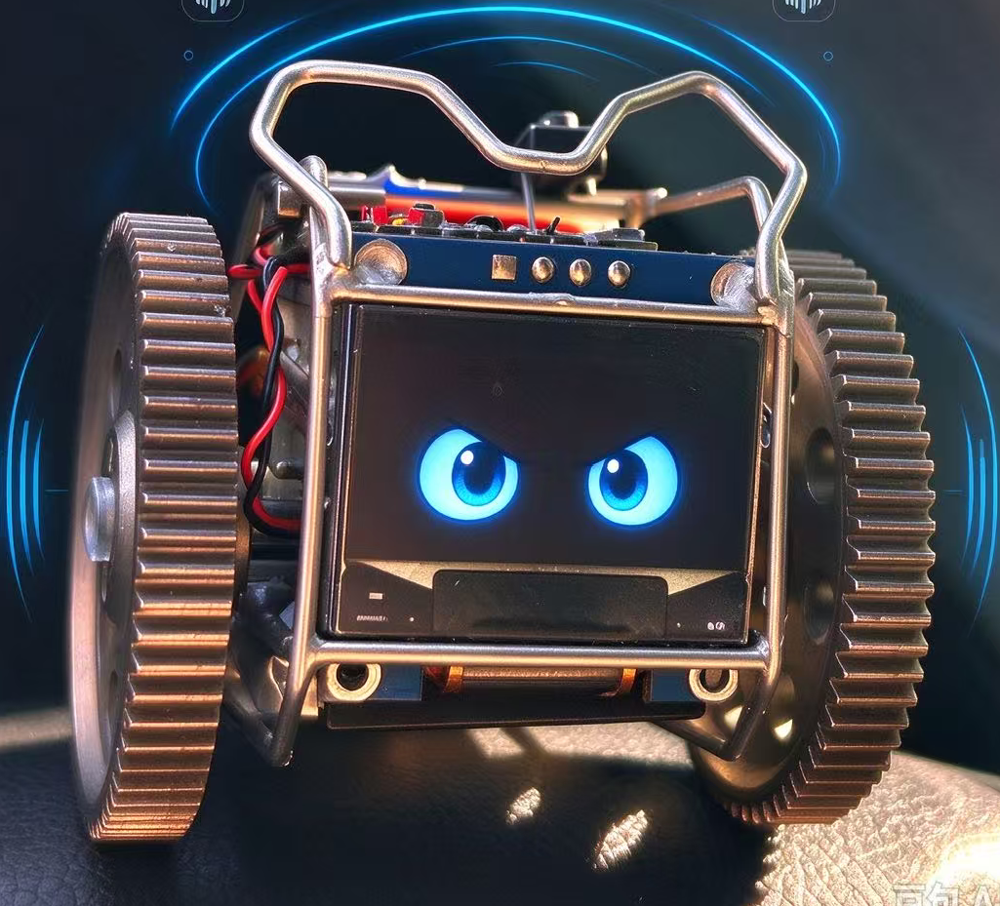

# 小智语音小车（C3 版）



基于 [xiaozhi-esp32](https://github.com/78/xiaozhi-esp32) 定制的两轮差速语音小车。

**板型** `qebabe-xiaoche-c3` ｜ **主控** ESP32-C3 ｜ **驱动** MX1508 双 H 桥 ｜ **显示** SSD1306 OLED

---

## 1. 它是什么

在「语音对话」的基础上加了一整套动作系统：

- **语音指挥**：说「往前走」「跳个舞」「摇摇头」，大模型自己决定调哪个 MCP 工具、用什么参数
- **网页遥控**：手机浏览器打开设备 IP，双摇杆实时驾驶，可调速度上限
- **OLED 表情**：一双会眨眼、会追焦、能表达情绪的眼睛，说话时嘴巴开合，待机显示时钟
- **单键三用**：BOOT 键 = 唤醒 / 打断播报 / 退出聆听回时钟

动作分三层：5 个电机原语 → 参数化差速 → 21 个预设动作 + 任意序列编排。细节见 [PROJECT.md](PROJECT.md)。

---

## 2. 硬件

| 项目 | 型号 / 引脚 |
|---|---|
| 主控 | ESP32-C3-MINI1（4MB Flash，单核 160MHz） |
| 麦克风 | MicroDeer I2S 模块（SCK=4, WS=5, SD=6） |
| 功放 | I2S 输出（BCLK=10, LRCK=20, DIN=21） |
| 显示 | 0.96" SSD1306 128×64（I2C：SCL=8, SDA=9，地址 0x3C） |
| 电机驱动 | HW-358 / MX1508 双 H 桥（无 ENA/ENB，4 线直控） |
| 电机 | 左右各一个 DC 减速电机，差速转向 |
| 按键 | 板载 BOOT 键（GPIO0，active_low） |
| 供电 | 单节锂电池 + LDO |

```
电机  LF=2  LB=1  RF=3  RB=7       (MX1508 IN1~IN4)
麦克风 SCK=4  WS=5  SD=6
功放   BCLK=10  LRCK=20  DIN=21
OLED   SCL=8  SDA=9
按键   BOOT=0
```

⚠️ GPIO18/19 是 USB D-/D+，绝对不能用；GPIO20/21 原为 UART console，已让给 I2S（日志走 USB CDC）。

---

## 3. 语音能说什么

| 说法 | 效果 |
|---|---|
| 往前走 / 后退 | 直线移动 |
| 左转 / 右转 | 差速转弯 |
| 原地转一圈 | 双轮反向 |
| 跳个舞 / 扭一扭 / 冲锋 | 组合动作 |
| 停下 | 立即停止 |
| 点头 / 摇头 | 表情动作 |

还可以带参数，比如「**以 50% 速度前进 3 秒**」。

21 个预设动作的完整清单、差速混控算法、多步序列格式见 [PROJECT.md](PROJECT.md) 第 4 节。

---

## 4. 网页遥控

设备连上 WiFi 后自动在 80 端口起服务：

1. 看串口日志里的 `Got IP: 192.168.x.x`
2. 同一 WiFi 下用手机/电脑浏览器打开 `http://192.168.x.x`
3. 点页面中间的 **「🎮 进入控制页面」**
4. 左摇杆控制电机差速，右侧可调速度上限

> 页面初始是锁定态，不点那个按钮是看不到摇杆的。

---

## 5. 编译与烧录

环境：**ESP-IDF v5.5.4**，目标芯片 `esp32c3`。

```bash
# 1. 激活 IDF 环境（路径按你自己的安装位置改）
#   Windows CMD:
C:\Espressif\frameworks\esp-idf-v5.5.4\export.bat
#   PowerShell:
. C:\Espressif\frameworks\esp-idf-v5.5.4\export.ps1

# 2. 进入项目根目录，编译
idf.py -B build_c3 build

# 3. 烧录（COM 口按实际改）
idf.py -B build_c3 -p COM3 flash
```

**开箱即用**：`sdkconfig.defaults` 里已经固定了板型 `qebabe-xiaoche-c3`，不需要进 menuconfig 选板子。

首次编译会自动拉取 `managed_components` 依赖（需要联网）。

> 本仓库只保留 C3 这一个板型，上游 xiaozhi-esp32 的其它几十款板卡已全部移除，`main/boards/` 下只有 `common/` 和 `qebabe-xiaoche-c3/`。

---

## 6. 目录结构

```
main/
├── boards/
│   ├── qebabe-xiaoche-c3/   ← 整车逻辑：电机、动作、OLED、距离传感器
│   └── common/              ← 公共板级基类
├── web_server/              ← 内置网页遥控服务
├── display/                 ← RoboEyes 眼睛动画 + OLED 渲染
├── assets/                  ← 音效、字体
└── ...
```

---

## 7. 开源地址

🔗 [GitHub 仓库](https://github.com/mohutubiao/ZHINENG-xiaoche-C3MINI)

---

## 8. 许可证

本项目以 **GNU General Public License v3.0** 发布，全文见 [LICENSE](LICENSE)。

之所以是 GPL-3.0：眼睛动画使用了 GPL-3.0 的 [RoboEyes](main/third_party/roboeyes/)，
按 GPL 的传染性，整个固件作为衍生作品一并以 GPL-3.0 发布。

- 基于 [xiaozhi-esp32](https://github.com/78/xiaozhi-esp32)（MIT 许可）定制，上游版权声明已完整保留在 [NOTICE](NOTICE)
- 第三方代码与素材（RoboEyes / Adafruit GFX / Twemoji / 字体 / 音频）的授权说明同样见 [NOTICE](NOTICE)

一句话：**可以自由使用、修改、分发，但分发衍生作品时必须同样以 GPL-3.0 开源。**

---

## 9. 交流

- 抖音：**创客久久**
